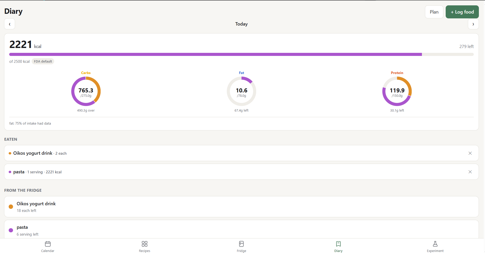
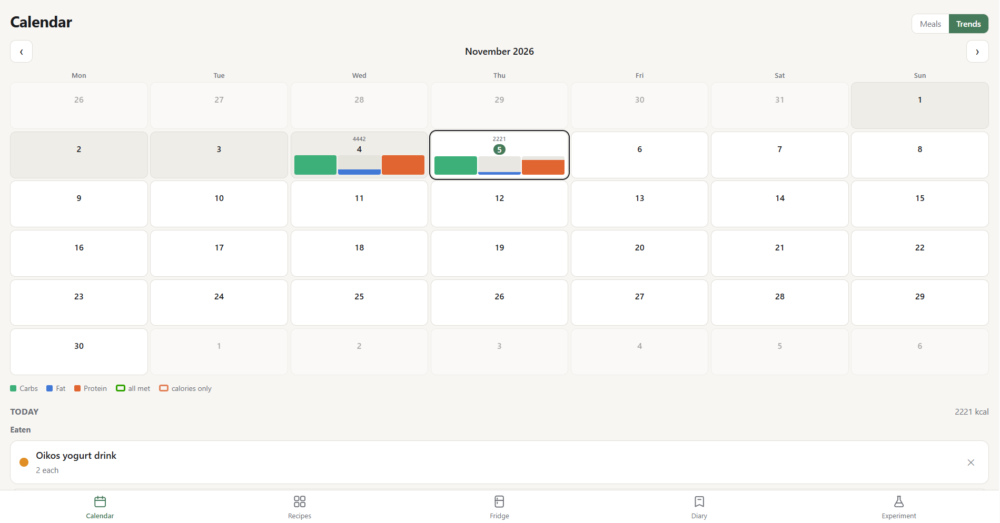
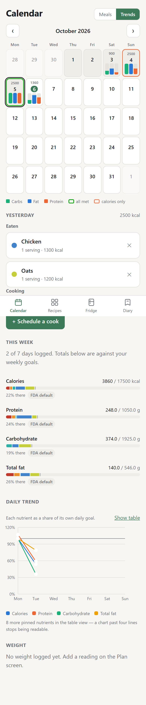

# Meal Prep

A meal-planning web app I designed for my own batch cooking. You build recipes from USDA food data, schedule cooks on a calendar, track leftovers as fridge stock, and log what you eat against a full nutrient plan, not just calories.

**Status:** in daily use on my phone and laptop. Installable as a PWA, works offline, syncs between devices through Cloudflare, with per-user accounts. 581 automated tests passing.

<p align="center">
  
  
  
</p>

## Why I built it

I meal prep in batches, and the apps I tried treated every meal as a one-off entry. None of them handled "I cooked six servings on Sunday and I'm eating them through Thursday," and most only tracked calories and macros. I wanted one place to plan a cook, see what's left in the fridge, and see whether I'm actually hitting my micronutrient targets over a week.

## What it does

1. **Recipes** — build something you cook a batch of from USDA-sourced ingredients, with live
   nutrition. Or define your own **foods** by hand for whatever the database has never heard of,
   then eat them, stock them, or use them in a recipe. Search results say whether a food is raw,
   cooked or dry, and whose it is.
2. **Calendar** — schedule a cook on a month grid. Cooking shows as a bar, eating as a dot. A
   Trends view shows each day's calories and macros instead, bordered green when every goal was met.
3. **Mark cooked** — confirm what actually went in and what it actually made; nutrition is
   recomputed from that rather than from the plan.
4. **Fridge** — stock, as counts or a percentage remaining. Things you simply bought go in too.
5. **Diary** — log from the fridge or quick-add. Calories as a bar, macros as rings, the full
   panel below — every bar split by the foods it came from.
6. **Plan** — every nutrient target, daily and weekly, seeded from FDA values and fully editable.
   Omega-3 and omega-6 are totalled from their individual fatty acids.
7. **Experiment** — draft a week (or any period) of food you might buy and cook in a scratchpad.
   See the average day, or drag the food onto particular days and see each one.

## How I built it

I wrote the product spec and made the design and data decisions; I built it with **Claude Code as my pair programmer**, which wrote most of the implementation while I directed the work, reviewed it, and tested every feature against real daily use. The design log I kept during the build is in [PLAN.md](PLAN.md).

Decisions I'm most proud of:

- **Missing data is never treated as zero.** USDA entries are often incomplete, so every total carries a coverage figure saying how much of it was actually measured, instead of quietly under-counting.
- **History is never rewritten.** Logged meals store a snapshot, so editing a recipe later doesn't change what I already ate.
- **One math path for counts and weights.** "2 servings" and "40% of the pot" go through the same calculation, which removed a whole class of bugs.
- **Local-first, then sync.** Every device keeps a full offline copy (IndexedDB) and syncs through a Cloudflare D1 database, so it works in a grocery store with no signal.
- **The API key never reaches the browser.** USDA lookups go through a Cloudflare Worker proxy that holds the key as a secret.
- **The server never sees a password.** The browser stretches it with Argon2id and sends only a derived proof; sessions are server-side and revocable, sign-in is rate-limited per user and per IP, and every user's data is keyed by their account so one user can't read or overwrite another's. Tests attack that isolation directly.

What I learned: how to scope a real project into phases, how to write specs precise enough that an AI tool builds the right thing, and how to verify AI-written code with tests and real use rather than trusting it.

## Roadmap

- **Security hardening** — strict CSP and security headers, CI with dependency and code scanning, a written threat model (next up)
- **End-to-end encryption** of synced data, with a recovery code
- Suggestions in the Experiment tab: what to eat for what the week is missing

## Running it

```powershell
npm install
npm run dev:api   # terminal 1 — wrangler on :8788, serves the /api proxy
npm run dev       # terminal 2 — vite on :5173, open THIS one
```

Both are needed: the app opens on a sign-in screen, and accounts live in the Worker's local database. Create an account at http://localhost:5173 to get in.

| Script                        | Does                                             |
| ----------------------------- | ------------------------------------------------ |
| `npm run dev`                 | Vite dev server, host exposed for phone testing  |
| `npm run dev:api`             | Wrangler serving the Worker and its `/api` proxy |
| `npm run build`               | Typecheck + production build to `dist/`          |
| `npm test`                    | Vitest                                           |
| `npm run lint` / `format`     | ESLint / Prettier                                |
| `npm run deploy`              | Build and deploy to Cloudflare from this machine |
| `node scripts/screenshot.mjs` | Visual check at phone and desktop widths         |
| `node scripts/admin.mjs`      | Account admin (reset a password, etc.)           |

## Stack

React 19 · TypeScript · Vite 7 · Dexie (IndexedDB) · React Router · Recharts · Workbox ·
Cloudflare Worker with static assets

## Docs

- [PLAN.md](PLAN.md): architecture, data model, and the design decisions and why
- [SETUP.md](SETUP.md): accounts, keys, and deployment setup
- [CLAUDE.md](CLAUDE.md): working notes for Claude Code sessions (conventions and current status)
